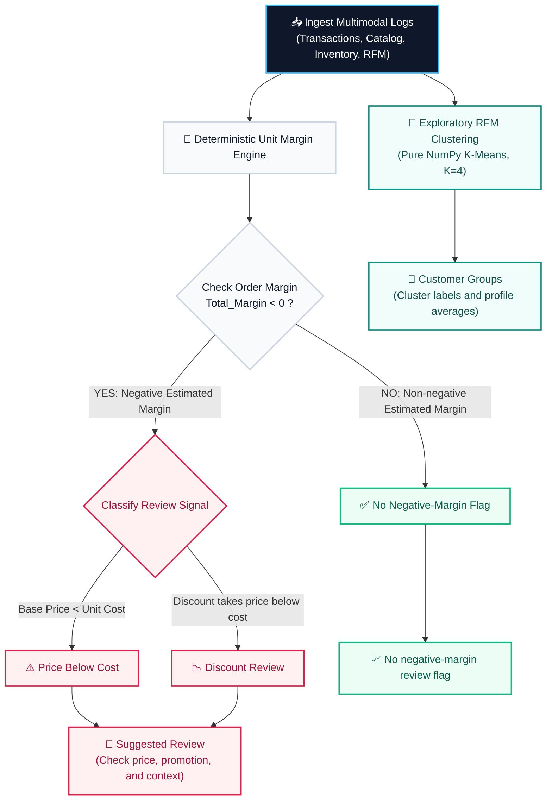
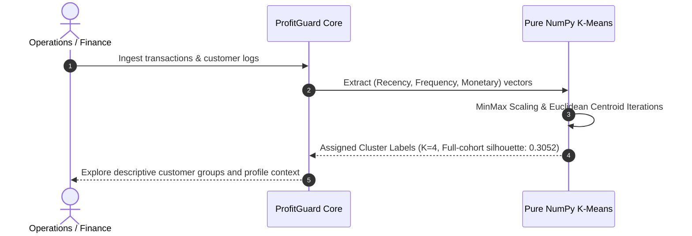

# 🛡️ ProfitGuard AI
### *Transaction Margin Review & Customer Segmentation Prototype*
[](https://saitejaswinikandimalla.github.io/profitguard-ai/)
[](https://opensource.org/licenses/MIT)
[](https://github.com/Saitejaswinikandimalla/profitguard-ai)
[](https://www.python.org/)

---

## 📌 Executive Summary

**ProfitGuard AI** is a prototype for **DATATHON 2026 — Track 4 (Business: The Money Leak)**. It reviews transaction-level unit economics, highlights records for human investigation, and groups customers using RFM features.

The prototype joins the supplied transaction and product data to estimate gross margin and explain each review flag. Its RFM clustering is exploratory; it does not predict churn, prove causes, change prices, or recover revenue.

---

## 📊 High-Impact Competition Audit Metrics

On the **18,000-row synthetic educational dataset supplied for Track 4**, ProfitGuard AI flags estimated negative gross margin for investigation. These figures describe this dataset only; they do not establish real-world performance or prove that the full amount is recoverable:

| Metric | Measured Value | Business Impact |
| :--- | :--- | :--- |
| **Completed Transacted Volume** | **₹73.02 Lakhs** | Total gross completed sales analyzed |
| **Estimated Negative Gross Margin** | **₹12.14 Lakhs** | **16.63% of completed revenue** in completed transactions with negative estimated gross margin |
| **Margin-Negative Orders** | **5,315 orders** | **38.07%** of completed transactions |
| **Base Price Inversion Orders** | **4,770 orders** | Across **76 unique SKUs** where transaction price is below unit cost |
| **Audited Customers (RFM)** | **2,971 profiles** | RFM features are derived from completed transaction history |

---

## 🔄 Transaction Review and RFM Flow



---

## 🏗️ System Architecture & Deployment Workflow

```mermaid
flowchart LR
    classDef tier fill:#ffffff,stroke:#64748b,stroke-width:1px,color:#0f172a;
    
    subgraph ClientTier["💻 1. Presentation Tier (Light SaaS UI)"]
        UI["Clean Modular UI<br/>(SalesPro / Tvora aesthetic)"]
        Charts["Dynamic Visualizations<br/>(Chart.js + Plotly)"]
        AuditModal["Step-by-Step Mathematical<br/>Audit Modal"]
    end

    subgraph ComputeTier["⚡ 2. Processing & Intelligence Tier"]
        CoreEngine["Deterministic Audit Engine<br/>(Python / Zero-Dependency)"]
        KMeans["From-Scratch K-Means<br/>(Pure NumPy / Full-cohort silhouette: 0.3052)"]
        Export["Static Pre-Bake & JSON Exporter"]
    end

    subgraph InfraTier["🌐 3. Delivery & Cloud Tier"]
        GH["GitHub Source Repository<br/>(Saitejaswinikandimalla/profitguard-ai)"]
        StaticHost["GitHub Pages Static Hosting<br/>(Bundled data.json)"]
    end

    ClientTier <--> ComputeTier
    ComputeTier --> InfraTier
    InfraTier --> StaticHost
    StaticHost --> ClientTier
```



---

## 🧮 Mathematical Audit Foundations

Every single transaction in the database is audited deterministically down to the exact paisa without statistical ambiguity:

### 1. Effective Selling Price
$$\text{Effective Price} = \text{Unit Price} \times (1 - \text{Discount Pct})$$

### 2. Unit Margin Economics
$$\text{Unit Margin} = \text{Effective Price} - \text{Unit Cost}$$

### 3. Total Transaction Margin
$$\text{Total Margin} = \text{Quantity} \times \text{Unit Margin}$$

### 4. Review Flags and Suggested Investigation
* **Price Below Cost**: Flags transactions where recorded base unit price is below unit cost. This is a review signal, not proof of an erroneous or unintentional price.
* **Discount Review**: The recorded base price is at least unit cost, but the assumed discount calculation makes the estimated realization lower than unit cost ($\text{Unit Price} \ge \text{Unit Cost} \land \text{Unit Margin} < 0$).
* **Returns**: Included in status summaries. The supplied data does not provide reverse-logistics costs, so this prototype does not estimate return loss.

---

## 🖼️ Application Screenshots & Visual Tour

### 1. Executive Intelligence Dashboard
*Topline KPIs, month-over-month revenue trends, margin health curves, and category breakdowns.*


### 2. Live Transaction Leakage Inspector
*Transaction review table with margin flags and step-by-step calculations.*


### 3. Unsupervised RFM Machine Learning Clusters
*Built from scratch using pure NumPy K-Means clustering ($K=4$) with Silhouette optimization.*


### 4. End-to-End Architectural Blueprint
*Clear decoupling between raw operational sources, analytics computation, and visual interfaces.*


---

## 👥 Customer Behavioral Intelligence (RFM)

Instead of relying on heavy external black-box frameworks, **ProfitGuard AI** implements **K-Means clustering entirely from scratch in pure NumPy** (`ml.py`):



K-Means returns cluster numbers and profile averages. The numbers are exploratory groups, not validated customer types or churn labels; the app does not trigger campaigns or prescribed actions.

---

## 🛠️ Technology Stack

| Domain | Technology / Library | Rationale |
| :--- | :--- | :--- |
| **Frontend UI** | HTML5, Vanilla JavaScript, CSS3 | Instant sub-second load times, crisp modern SaaS aesthetic |
| **Visualization** | Chart.js, Mermaid.js | Clean responsive graphs, dynamic line curves, interactive scatter |
| **Backend Engine** | Python 3 (Native HTTP Server) | Zero external dependencies, portable across any OS/cloud |
| **Machine Learning** | Pure NumPy (`ml.py`) | Handcrafted K-Means algorithm demonstrating mathematical rigor |
| **Hosting** | GitHub Pages static frontend; local Python / optional Streamlit | Static demo plus local full-data workflows |

### Evaluation, data limits & external services

- The full-cohort K-Means silhouette score is **0.3052** for K=4 using RFM features, standardization, five random initializations, and seed 42. The Streamlit UI reports an approximate score on a deterministic 1,000-customer sample (**0.2999**). These are descriptive clustering scores, not predictive accuracy or evidence of real-world impact. The transaction review table uses transparent rule-based flags; it does not show a calibrated risk score.
- The provided Track 4 files are synthetic educational data. All money-at-risk values are estimates from the stated unit-margin formula; the app does not integrate with checkout or recover revenue.
- No hosted AI model, third-party AI API, or extra dataset is used. K-Means is implemented in `backend/ml.py`. The browser dashboard loads Chart.js from jsDelivr; the Streamlit sidebar loads its shield image from Icons8. The local Python server exposes its own `/api/data` endpoint and the static site falls back to `data.json`.
- The public static dashboard and optional Streamlit dashboard are separate interfaces. The Streamlit app reads all five supplied CSVs: transactions and products for margin review, customer profiles to enrich RFM exploration, inventory for stockout/supplier-delay summaries, and campaigns for channel spend/conversion summaries. These are descriptive analyses; they do not claim causal impact.

---

## 🚀 Quick Start & Local Run

### 1. Clone Repository
```bash
git clone https://github.com/Saitejaswinikandimalla/profitguard-ai.git
cd profitguard-ai
```

### 2. Run the full local prototype (Zero Setup)
```bash
python backend/server.py
```
Open **`http://localhost:8501`** in any web browser.

The local dashboard loads all 18,000 transactions and 2,971 customer profiles. Search across orders, filter by leakage type, inspect the per-order margin calculation, page through results, and export the current filtered set as CSV. Charts and summary cards are calculated from the loaded data.

### 3. Refresh the static hosting data

GitHub Pages uses the bundled `data.json` file. After changing the source CSV files, regenerate it before deploying:

```bash
python backend/build_data.py
```

### 4. Run Streamlit Application (Alternative)
```bash
python -m pip install -r backend/requirements.txt
streamlit run backend/app.py
```

---

## 📁 Repository File Structure

```
profitguard-ai/
├── index.html                  # Standalone client application for cloud hosting
├── data.json                   # Precomputed dataset for static hosting
├── vercel.json                 # Vercel deployment and routing configuration
├── backend/                    # Core Python engine and ML algorithms
│   ├── server.py               # Python HTTP server with first-party data endpoint and web UI
│   ├── app.py                  # Interactive Streamlit analytics dashboard
│   ├── ml.py                   # Pure NumPy RFM feature extractor & K-Means engine
│   └── requirements.txt        # Dependency list
├── data/                       # Datathon Track 4 CSV datasets
│   ├── transactions.csv
│   ├── products.csv
│   ├── customers.csv
│   ├── inventory.csv
│   └── campaigns.csv
└── screenshots/                # Application verification screenshots
    ├── screen1_executive.png
    ├── screen2_minimal_light.png
    ├── screen2_leakage.png
    ├── screen3_ml_clusters.png
    └── screen4_architecture.png
```

---

## 🎓 Competition & Submission Details
* **Competition**: **DATATHON 2026**
* **Host Organization**: Data Science Club, VIT-AP University & IIEC
* **Track**: Track 4 — Business (*The Money Leak*)
* **Lead Developer & Submitter**: **Sai Tejaswini Kandimalla** ([@Saitejaswinikandimalla](https://github.com/Saitejaswinikandimalla))
* **License**: [MIT](LICENSE)
